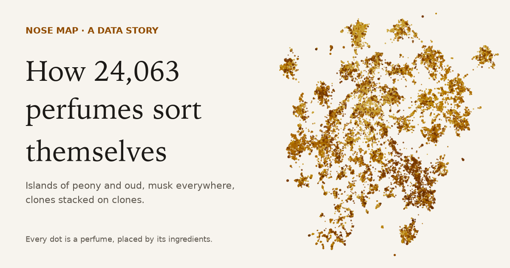
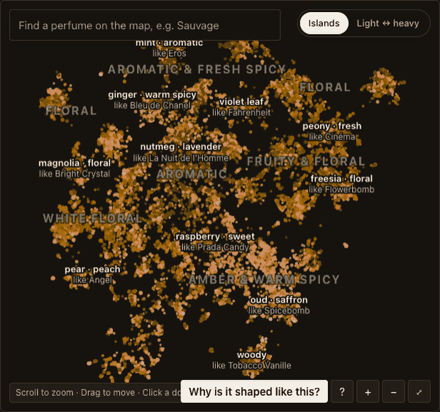
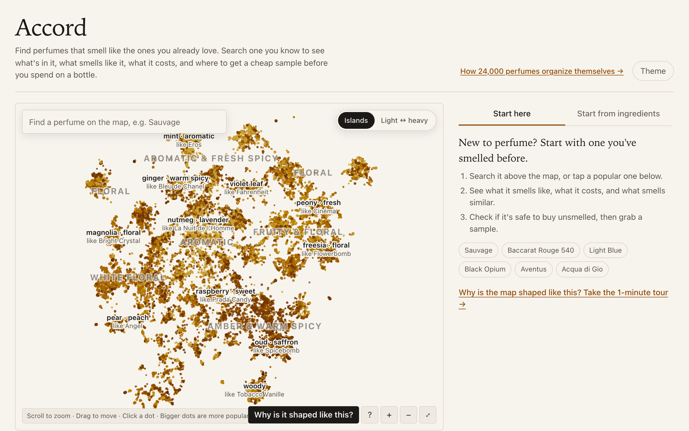
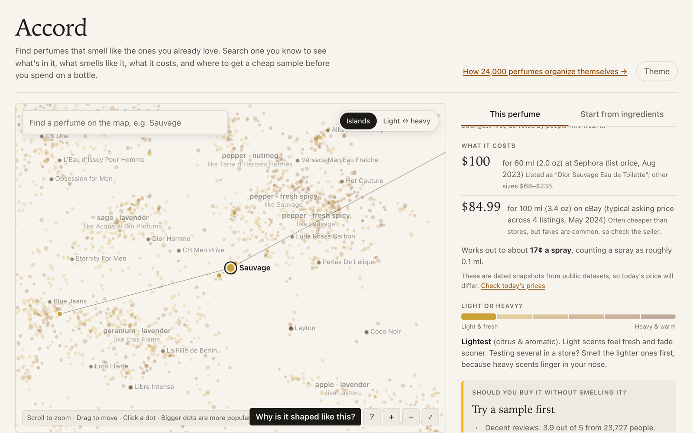
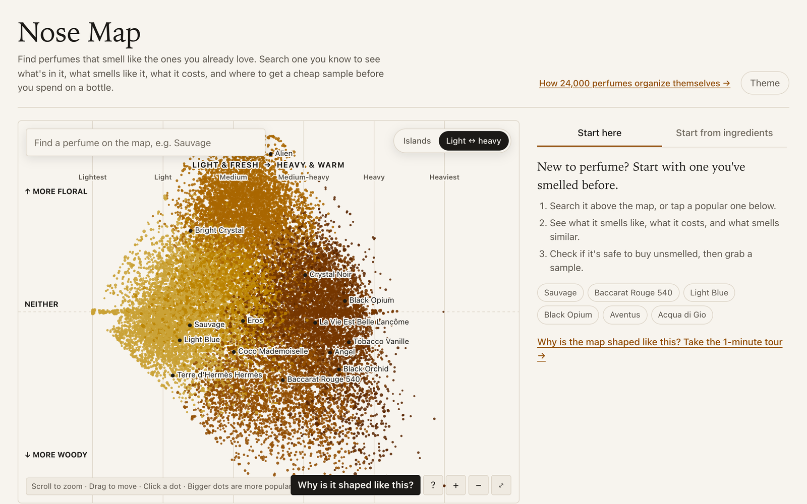
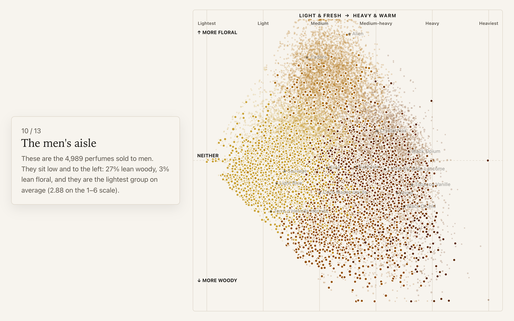
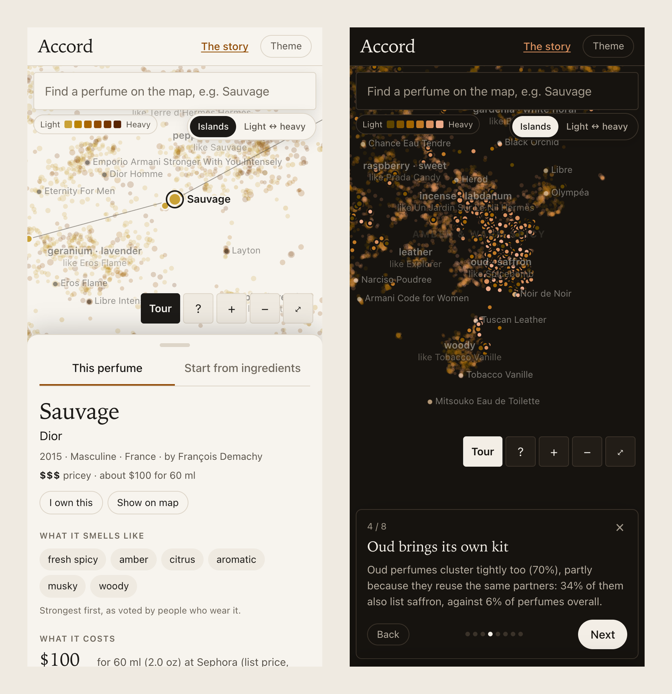
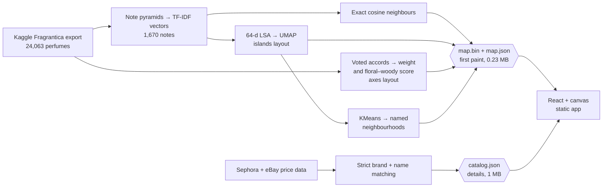

<p align="center">
  
</p>

<h1 align="center">Accord</h1>

<p align="center">
  Find perfumes that smell like the ones you already love.<br />
  24,063 perfumes placed by their ingredients, with prices, sample links and a blind-buy check for each one.
</p>

<p align="center">
  <a href="https://accord-map.vercel.app"><b>Open the map</b></a> ·
  <a href="https://accord-map.vercel.app/story"><b>Read the story</b></a> ·
  <a href="#how-it-works">How it works</a> ·
  <a href="#run-it-yourself">Run it yourself</a>
</p>

<p align="center">
  
</p>

---

Every perfume in the store starts to smell like alcohol after the fifth tester. Accord is for the part before
that: deciding what is worth smelling at all. Search a perfume you know, see what it is made of, what smells like
it, what it costs, and whether a cheaper bottle lists the same ingredients.

The name comes from perfumery: an accord is a handful of notes blended until they read as one new smell.

Nobody drew the map. A computer read every perfume's ingredient list and put the ones that share ingredients next
to each other. The result has real structure: islands built around signature notes like peony, mint and oud, musk
sprinkled everywhere, and clones stacked on top of the perfumes they copy.

## What you can do

### Find any perfume and see who its neighbours are



- **Search lands you on the map.** Pick a result and the map glides there and pulses the dot. Hovering a result shows where it lives first.
- **Labels work like a printed map:** broad scent families when zoomed out, 29 ingredient neighbourhoods ("mint · aromatic, like Eros") on top, and 89 finer ones plus the best-known bottles as you zoom in.
- **Bigger dots are more popular,** so the perfumes you have heard of stand out.
- **A one-minute tour** ("Why is it shaped like this?") flies through the map's structure with numbers measured from the data.

### Decide whether to buy it



- **What it smells like:** the accords wearers voted for, in plain words, and how it changes from the first spray to the base.
- **What it costs:** a dated list price (Sephora, Aug 2023) and a typical eBay asking price (May 2024) for 875 perfumes, a price range for 102 more houses, a $ to $$$$ tier and a cost per spray.
- **Should you buy it unsmelled?** A rule-of-thumb check that weighs the crowd rating (shrunk toward average when few people voted), how divisive the scent family is, and how close it is to bottles you marked as owned.
- **A cheaper route:** when an affordable house lists nearly the same ingredients, it says so. Baccarat Rouge 540 points to Armaf's Club de Nuit Untold, 100% alike on paper.
- **Try it before you buy it:** live searches on decant and sample sites, then on stores. No affiliate links.

### Switch from islands to axes



One toggle morphs the map into a chart: **light to heavy** from left to right and **woody to floral** from bottom
to top. The second axis was picked because it barely overlaps with the first (r = −0.14); fresh-versus-warm would
have repeated it (r = −0.95).

### Read the story



[`/story`](https://accord-map.vercel.app/story) is a 13-step scroll-driven explainer,
*How 24,063 perfumes sort themselves*. The map is pinned beside the text and moves as you scroll. Every number in
the copy is read from data the pipeline measured, so the words can't drift from the data.

### Use it on a phone in the store

<p align="center">
  
</p>

On phones the map goes full screen with search on top and details in a sheet you drag up. The map draws from a
0.23 MB file before the full catalog arrives: on a simulated 1.6 Mbps connection it appears in about 3.7 s, with
search ready at about 8.5 s.

## What the data says

All of these are measured by the pipeline and quoted on the story page.

| Finding | Number |
| --- | --- |
| Signature ingredients form islands. Around a peony perfume, this share of its 20 nearest dots also list peony | **82%** (6% of all perfumes do) |
| Same for mint, tuberose and oud | 84%, 79%, 70% |
| Oud brings saffron with it | 34% of oud perfumes list saffron, against 6% overall |
| Common ingredients don't decide where a perfume lands. Musk, in nearly half of all perfumes | 54% of neighbours, against a 46% baseline |
| Perfumes sold to men lean woody, not floral | 27% woody, 3% floral |
| Perfumes sold to women do the opposite | 44% floral, 5% woody |
| Perfume is getting heavier | Average weight 2.97 (1980–99) → 3.33 (2016–24) on a 1–6 scale |

## How it works



**Does the map mean anything?** Ingredient lists come from brands; accords are what thousands of wearers voted a
perfume smells like. If the ingredient space is meaningful, a perfume's nearest matches should share its top-voted
accord. They do, 3.6 times more often than chance:

| Vectors | Share of 10 nearest matching the top accord | Matching the light/heavy tier |
| --- | --- | --- |
| Binary note presence | 26.6% | 40.2% |
| **TF-IDF, all layers equal (shipped)** | **27.1%** | **40.5%** |
| TF-IDF, base notes weighted up | 24.3% | 38.0% |
| Random pick | 7.5% | 19.6% |

Weighting the base notes up seemed right, since they are what survives the drydown. It made the matches worse, so
every layer counts the same.

**Spreading the islands.** The layout is UMAP on a 64-dimension LSA reduction, with extra repulsion. Against the
earlier settings that left 59% of the map empty instead of 44%, and 2-D neighbours kept slightly more of the true
top ten (recall 0.104 against 0.082). The map is still approximate, so "smells similar" lists use the exact
comparison, computed in the browser in a few milliseconds.

**Loading fast.** Positions for both layouts, shade and popularity live in a 10-bytes-per-perfume binary file. The
browser computes neighbours itself from the note lists (99.8% identical to the pipeline's), which halved the
catalog download.

## Run it yourself

The built data files are in the repo, so the app runs without downloading anything:

```sh
cd web
npm install
npm run dev            # http://localhost:5173
```

To rebuild the data from scratch:

```sh
# Fragrantica export and the two price datasets (public Kaggle downloads, no login needed)
mkdir -p data/raw/prices
curl -L -o /tmp/f.zip https://www.kaggle.com/api/v1/datasets/download/olgagmiufana1/fragrantica-com-fragrance-dataset
unzip -o /tmp/f.zip -d data/raw
for d in nadyinky/sephora-products-and-skincare-reviews muneebmuhammadali/perfume-e-commerece-dataset; do
  curl -L -o /tmp/p.zip https://www.kaggle.com/api/v1/datasets/download/$d
  unzip -o /tmp/p.zip -d data/raw/prices/$(basename $d)
done

uv venv --python 3.12 .venv
uv pip install --python .venv/bin/python -r pipeline/requirements.txt
.venv/bin/python pipeline/build.py     # about 90 s: vectors, layouts, labels, prices, share image
```

To check the production runtime locally: `cd web && npm run build && npx wrangler dev --config ../wrangler.jsonc`.

## Project layout

```
pipeline/
  build.py          data → vectors → benchmark → layouts → labels → story numbers → web/src/generated
  prices.py         Sephora and eBay price matching
  og_image.py       share image rendered from the map
web/
  src/App.tsx       the app shell, search, phone bottom sheet
  src/MapView.tsx   canvas map: islands/axes morph, labels, camera, touch
  src/Detail.tsx    a perfume's panel: costs, blind-buy check, cheaper route, shop links
  src/Tour.tsx      the in-app tour
  src/story/        the /story explainer
  src/generated/    built data (map.bin, map.json, catalog.json)
worker/index.js     Cloudflare Worker serving the static build
docs/               README images
```

## Data, licences and limits

- **Code:** MIT, see [LICENSE](LICENSE).
- **Perfume data:** the [Fragrantica.com Fragrance Dataset](https://www.kaggle.com/datasets/olgagmiufana1/fragrantica-com-fragrance-dataset) on Kaggle, CC BY-NC-SA 4.0. The built files in `web/src/generated/` derive from it and carry the same licence. See [DATA-LICENSE.md](DATA-LICENSE.md). Nothing here scrapes Fragrantica; perfume pages link to the source.
- **Prices:** [Sephora product data](https://www.kaggle.com/datasets/nadyinky/sephora-products-and-skincare-reviews) (CC BY 4.0, Aug 2023) and [eBay perfume listings](https://www.kaggle.com/datasets/muneebmuhammadali/perfume-e-commerece-dataset) (ODC-By, May 2024). They are snapshots, not live prices. Niche houses not sold at Sephora in 2023, such as Maison Francis Kurkdjian, mostly have none.
- **Hand-made rules:** the blind-buy check, the list of affordable houses and the six light-to-heavy families are judgement calls written into the code, not trained models.
- **A shared ingredient list isn't a shared smell.** Concentration and material quality matter, and brands write the lists.

## What's next

- **In-store session mode:** five testers ordered light to heavy, a locked 20-minute rating timer so you never rate the alcohol, and blind rating with a reveal.
- **Live prices** through a shopping API or affiliate feed.
- **How long it lasts:** mining review text ("gone by lunch", "still there at hour eight") for a longevity estimate.

---

Built by [Shri Charan Sriram](https://github.com/Shri2007).
